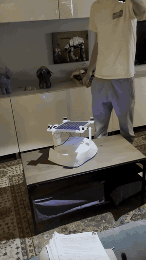
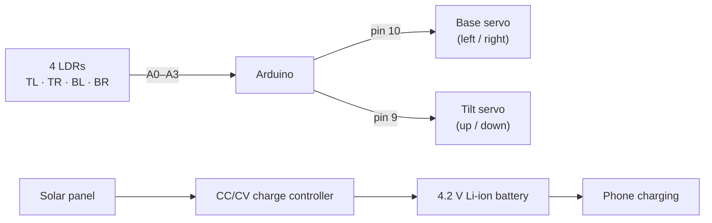
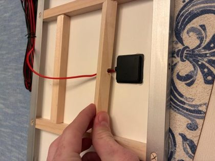
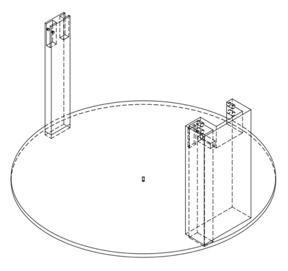
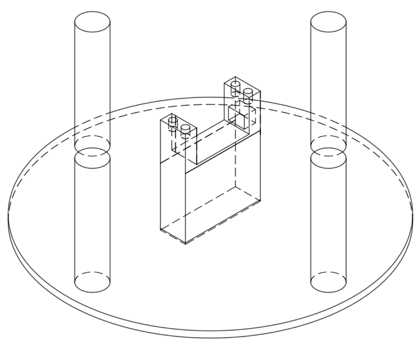
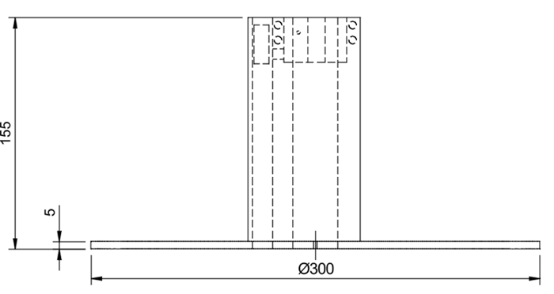
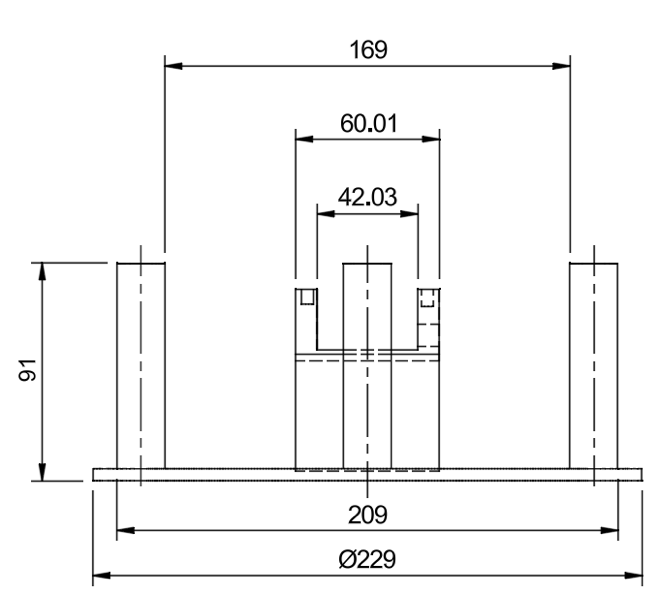

# Dual-Axis Solar Tracker

A solar panel that turns itself to face the brightest light. Four light sensors (LDRs) at the corners of the panel tell an **Arduino** which side is brighter, and two **servos** turn the base and tilt the panel until all four sensors read the same. The panel charges a 4.2 V lithium-ion battery that can then charge a phone.



▶️ **[Demo video](https://www.youtube.com/watch?v=wJlKHDskYjY)**

*Right: the panel following a flashlight around the room.*

Built as an independent project for my Grade 12 computer engineering course at Royal St. George's College (2026).

**Highlights**
- **Two-axis tracking:** a base servo turns left and right, and a tilt servo moves the panel up and down.
- **A simple control loop:** compare left vs right and top vs bottom, then step 1° toward the brighter side.
- **A dead band** of 10 % stops the servos twitching when the light is nearly centred.
- **Unlimited turning from a 180° servo:** when the base hits the end of its range, the tracker flips over the top and keeps tracking ([how](#the-flip-trick)).
- **A 3D-printed mechanism I designed**, with felt-padded pillars instead of bearings.

<br clear="right"/>

---

## How it works



### Finding the light

Each LDR sits in a voltage divider with a 10 kΩ resistor, so **brighter light gives a higher reading**. Every 50 ms the code adds the readings up in pairs:

```
left  = TL + BL        top    = TL + TR
right = TR + BR        bottom = BL + BR
```

- **Left / right:** if the two sides differ by more than **10 %**, the base servo steps 1° toward the brighter side.
- **Up / down:** if top and bottom differ by more than 10 %, the tilt servo steps 1° toward the brighter side. Tilt stays within a safe range of 50°–140°.

When the light is centred, all four sensors see about the same brightness, both differences fall under 10 %, and the panel holds still. Each LDR also has a calibration multiplier in the code to even out small differences between sensors.

### The flip trick

A hobby servo only turns about 180°, so the base would get stuck when the light moves past the end of its range. When the base reaches its limit (5° or 175°), the code:

1. swings the base to the mirror position (`180 − angle`), almost half a turn the other way;
2. tips the panel over the top at the same time (`tilt → 180 − tilt`), so it ends up facing the **same direction** from the other side;
3. swaps left and right while the panel is upside-down, since the sensors are now reversed.

Both servos move together in 2° steps, so the flip is smooth. A **5-second cooldown** stops the tracker flipping back and forth when the light sits right at the edge.

---

## Mechanical design

| Wooden panel frame | Top part (tilt) | Base (turn) |
|:---:|:---:|:---:|
|  |  |  |

- **Frame:** light wooden strips hold the panel. Keeping it light means the servos need less torque.
- **Top part (Ø 300 mm, 155 mm tall):** one pillar holds the tilt servo sideways, driving one side of the frame. The other pillar holds a metal rod as a free pivot for the other side. A hole down one pillar routes the panel and LDR wires to the electronics in the base, so they don't tangle.
- **Base (Ø 229 mm):** the base servo sits in the centre and turns the whole top part. Four pillars topped with **felt pads** carry the weight and let the top slide around smoothly, with no bearings.

| Top part, side view | Base, side view |
|:---:|:---:|
|  |  |

### Charging

The panel charges a 4.2 V lithium-ion cell through a **CC/CV** charge controller:
- **Constant current:** full current goes into the battery while its voltage rises.
- **Constant voltage:** at 4.2 V, the controller holds the voltage and the current tapers off. The battery counts as full when the current falls to about 10 % of its starting value.

---

## Wiring

| Part | Arduino pin |
|---|---|
| Top-left LDR | A0 |
| Bottom-left LDR | A1 |
| Top-right LDR | A2 |
| Bottom-right LDR | A3 |
| Tilt servo | 9 |
| Base servo | 10 |

Each LDR connects between 5 V and its analog pin, with a 10 kΩ resistor from the pin to ground.

## Code

[`solar_tracker/solar_tracker.ino`](solar_tracker/solar_tracker.ino) uses the built-in `Servo` library. Settings at the top of the file:

| Setting | Default | What it does |
|---|---|---|
| `THRESHOLD_PERCENT` | 10 | How different the sides must be before the servos move |
| `STEP_SIZE` | 1° | How far each servo moves per step |
| `DELAY_TIME` | 50 ms | Time between steps (speed of tracking) |
| `HOR_MIN` / `HOR_MAX` | 5° / 175° | Base limits that trigger a flip |
| `FLIP_COOLDOWN` | 5000 ms | Minimum time between flips |

---

## What I learned

- **Closed-loop control:** reading sensors, finding an error and correcting it step by step, plus why a dead band matters.
- **Working around hardware limits in software:** the flip trick gets continuous tracking out of a 180° servo.
- **Mechanical design:** designing parts for 3D printing, building a light frame, and using simple tricks like felt pads in place of bearings.
- **Battery charging:** how a CC/CV charger protects a lithium-ion cell.

## Possible improvements

- Put the electronics on a custom PCB inside the base.
- Measure the power from the tracker against a fixed panel to show the gain.
- Park the panel and sleep at night to save power.
